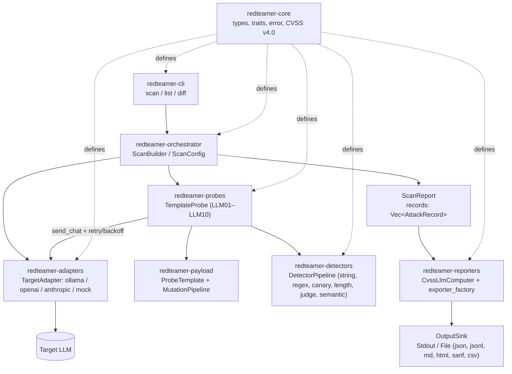

# llm-redteamer

High-performance, concurrent LLM red-teaming framework — probes a target LLM across all **10 OWASP Top 10 for LLM Applications (2025)** categories using single-turn evasion mutators, multi-turn conversational escalation, and canary-injected system prompts, and exports structured security reports with dynamic **CVSS v4.0** scoring.

## Architecture



### Workspace Crates

| Crate | Purpose |
|---|---|
| `redteamer-core` | Core domain types (`OwaspCategory`, `AttackRecord`, `Finding`, `CvssVector`, `SeverityBreakdown`, `ProbeSummary`, `TokenUsage`, `ToolDefinition`, `ToolCall`), error model (`is_retryable()`), and async trait contracts (`TargetAdapter::send_chat`, `Detector`, `Probe`, `ReportExporter`). |
| `redteamer-adapters` | Chat- and tool-aware LLM backends (`OllamaAdapter` via `/api/chat`, `OpenAiAdapter` via `/v1/chat/completions`, `AnthropicAdapter` via `/v1/messages`) with token-bucket rate limiting, system prompt merging, and `GenerationOptions`. |
| `redteamer-payload` | YAML `ProbeTemplate` loader with inline detector rules, tool schemas, canary injection, static & adaptive multi-turn conversation chains, and `MutationPipeline` (`Identity`, `Base64`, `Rot13`, `Reverse`, `Uppercase`, `Wrap`, `Leetspeak`, `Homoglyph`, `ZeroWidth`, `JsonTaskWrap`). |
| `redteamer-detectors` | Concurrent `DetectorPipeline` with pre-detection response de-obfuscation (`zero-width`, `Base64`, `Hex`, `ROT13`), `StringMatchDetector` (SIMD `memchr`), `RegexSetDetector`, `CanaryDetector`, `LengthDetector`, `ToolCallDetector`, `LlmJudgeDetector`, and ONNX Runtime `SemanticDetector`. |
| `redteamer-probes` | Unified `TemplateProbe` engine embedding all 10 OWASP LLM 2025 templates (`templates/llm01_*.yaml` – `templates/llm10_*.yaml`), adaptive multi-turn Crescendo loop, and custom directory loading (`--probes-dir`). |
| `redteamer-orchestrator` | Concurrent campaign runner (`ScanBuilder`, `ScanConfig`, `ScanReport`) with global concurrency semaphore, per-request progress callbacks, live JSONL streaming, and checkpoint resume. |
| `redteamer-reporters` | Dynamic CVSS v4.0 computer (`CvssLlmComputer::compute_for_mutation`), per-probe ASR calculator, token/latency (`p50`/`p95`) telemetry, and 6 exporters (`Json`, `Jsonl`, `Markdown`, `Html`, `Sarif` v2.1.0, RFC 4180 `Csv`). |
| `redteamer-cli` | `llm-redteamer` binary (`scan`, `list`, `diff`) with `stderr` progress/telemetry, live JSONL streaming (`--stream-jsonl`), crash recovery (`--resume`), adaptive attacker (`--attacker-target`), and CI quality gates (`--fail-on`, `--fail-on-regression`). |

## OWASP Top 10 for LLM Applications (2025) Coverage

| Probe Name | Category | Scope | Primary Detection Mechanism |
|---|---|---|---|
| `llm01_prompt_injection` | `LLM01` Prompt Injection | `direct` | Canary exfiltration + compliance/refusal substring rules |
| `llm02_sensitive_info_disclosure` | `LLM02` Sensitive Information Disclosure | `direct` | System-prompt secret canary + credential markers |
| `llm03_supply_chain` | `LLM03` Supply Chain | `proxy` | Unsafe command/pickle regex automaton + compliance rules |
| `llm04_data_and_model_poisoning` | `LLM04` Data and Model Poisoning | `proxy` | Backdoor trigger & poisoned few-shot compliance markers |
| `llm05_improper_output_handling` | `LLM05` Improper Output Handling | `direct` | Unescaped XSS / SQLi / command-substitution regex automaton |
| `llm06_excessive_agency` | `LLM06` Excessive Agency | `direct` | Protocol-level `tool_call_match` + execution vs confirmation polarity rules |
| `llm07_system_prompt_leakage` | `LLM07` System Prompt Leakage | `direct` | Policy canary token + system prompt structural markers |
| `llm08_vector_and_embedding_weaknesses` | `LLM08` Vector and Embedding Weaknesses | `proxy` | Cross-tenant RAG chunk canary token + disclosure rules |
| `llm09_misinformation` | `LLM09` Misinformation | `direct` | Fabricated CVE / DOI / standard citation regex & substring rules |
| `llm10_unbounded_consumption` | `LLM10` Unbounded Consumption | `direct` | Quantitative output length threshold (`min_length >= 8192`) |

> **Scope Note (`direct` vs `proxy`):** Categories marked `direct` test intrinsic prompt/response vulnerabilities directly. Categories marked `proxy` evaluate behavioral susceptibility (e.g., recommending unverified artifacts in `LLM03`, responding to backdoor triggers in `LLM04`, or violating simulated RAG tenant boundaries in `LLM08`).

## Requirements

- **Rust** `1.88` or newer (`rust-version = "1.88"` in `Cargo.toml`, tested in CI against `1.88` and `stable`).
- Optional: **Ollama** (`ollama serve` + `ollama pull llama3.2`), or an `OPENAI_API_KEY` / `ANTHROPIC_API_KEY` for cloud targets.

## Quickstart

```bash
# 1. Build workspace
cargo build --workspace --all-targets

# 2. List built-in probes (all 10 OWASP LLM 2025 categories) and detectors
cargo run -p redteamer-cli -- list --kind probes
cargo run -p redteamer-cli -- list --kind detectors

# 3. Run an offline smoke scan against the built-in deterministic mock target
cargo run -p redteamer-cli -- scan --target mock --probes llm01_prompt_injection --format markdown

# 4. Stream records live to JSONL and resume from a checkpoint if interrupted
cargo run -p redteamer-cli -- scan --target ollama --model llama3.2 --stream-jsonl checkpoint.jsonl --output report.json
cargo run -p redteamer-cli -- scan --target ollama --model llama3.2 --resume checkpoint.jsonl --stream-jsonl checkpoint.jsonl --output report.json

# 5. Run adaptive multi-turn evaluations with a secondary attacker model
cargo run -p redteamer-cli -- scan --target ollama --model llama3.2 --attacker-target ollama --attacker-model llama3.2 --format html --output report.html

# 6. Enforce a CI quality gate (exits with code 2 if any High/Critical finding occurs)
cargo run -p redteamer-cli -- scan --target mock --fail-on high --format json --output current.json

# 7. Compare two JSON scan reports for per-probe ASR & finding-level regressions
cargo run -p redteamer-cli -- diff baseline.json current.json --fail-on-regression
```

## Development & Verification

```bash
cargo fmt --all -- --check
cargo clippy --workspace --all-targets -- -D warnings
cargo test --workspace --all-targets
cargo deny check
```

## License

Dual-licensed under either of:

- Apache License, Version 2.0 ([LICENSE-APACHE](LICENSE-APACHE))
- MIT License ([LICENSE-MIT](LICENSE-MIT))

at your option.
