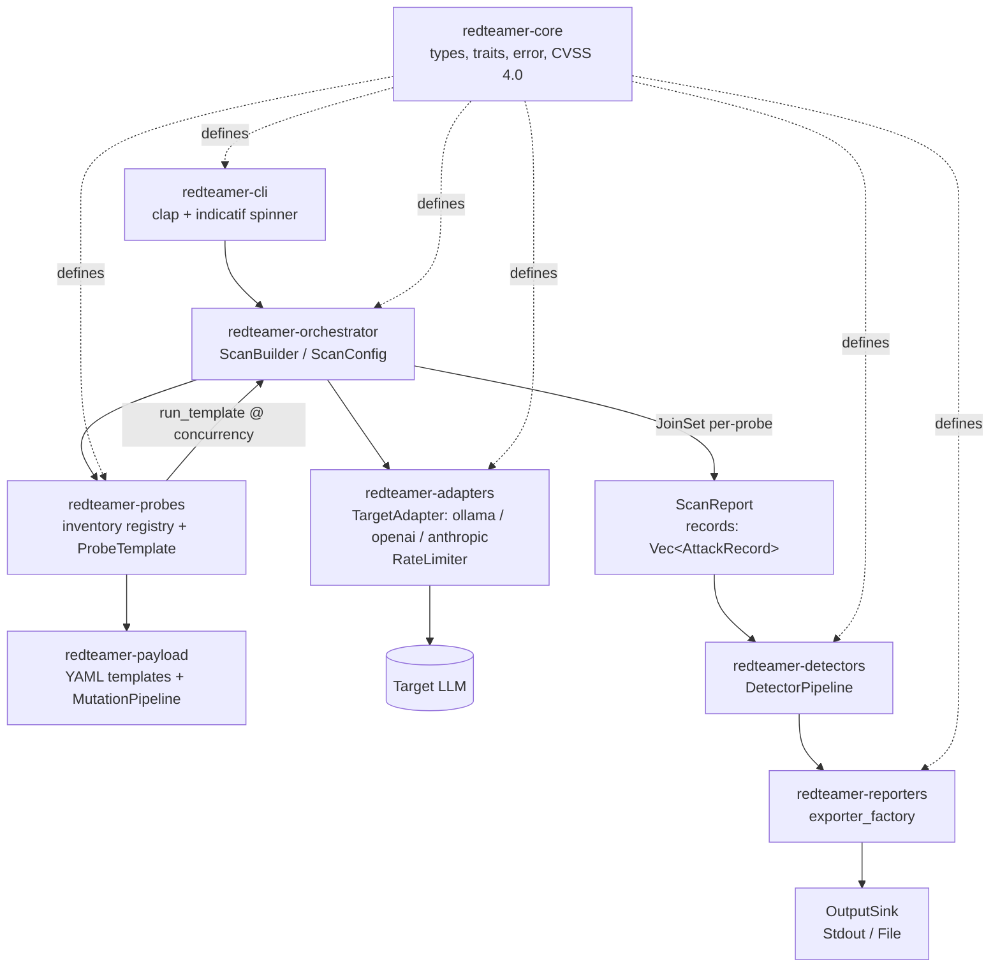

# llm-redteamer

High-performance, concurrent LLM red-teaming framework — probes a target LLM with OWASP LLM Top 10 payloads and reports vulnerable vs resistant behavior. Built as a Rust workspace with trait-based boundaries between core types, adapters, probes, detectors, orchestration, and reporting.

> **Status:** Early but runnable. Scans execute locally against Ollama (or OpenAI/Anthropic via API), detectors are partially stubbed, and reporting is exporter-based. See **Limitations** below for what is actually wired today.

## Architecture

Verified against `crates/*/src/lib.rs` doc comments and `crates/redteamer-orchestrator/src/scan.rs:40` `ScanConfig::execute()`:



**Flow in code:**

1. `redteamer-cli/src/main.rs:74` `Cli::parse()` → `run_scan()` at `main.rs:95` builds `OllamaAdapter`/`OpenAiAdapter`/`AnthropicAdapter` (`crates/redteamer-adapters/src/lib.rs:3`), selects probes via `redteamer-probes::all_probes()` / `probes_by_name()` (`crates/redteamer-probes/src/lib.rs:60`).
2. `ScanBuilder::new().target(adapter).probes(probe_ptrs).on_record_progress(|count| pb.set_message(...)).build()` (`crates/redteamer-orchestrator/src/scan.rs:127`) → `ScanConfig::execute()` at `scan.rs:46` fans probes via `tokio::task::JoinSet` (`scan.rs:47`), each `probe.run(session_id, target, concurrency)` (`scan.rs:54`) internally uses `run_template()` (`crates/redteamer-probes/src/lib.rs:88`) with `Semaphore` per-payload concurrency.
3. `while let Some(joined)=tasks.join_next().await` at `scan.rs:60` does `report.records.extend(records)` and fires `progress_callback(report.records.len())` if set (`scan.rs:62`) — once per completed probe, not per record. `pb.enable_steady_tick(Duration::from_millis(100))` at `main.rs:170` ticks spinner, `pb.finish_and_clear()` at `main.rs:183` wipes before summary `println!("scan finished …")` at `main.rs:185`.
4. Detectors (`Detector::detect()` at `crates/redteamer-core/src/traits/detector.rs:14`) run via `DetectorPipeline` (`crates/redteamer-detectors/src/pipeline.rs:15`) — see **Detectors** below.
5. `ScanReport` (`scan.rs:82`) holds `records: Vec<AttackRecord>` + `failed_probes`; `CvssVector::score()` at `crates/redteamer-core/src/types.rs:198` now uses RustSec `cvss 2.2` `v4::Vector` macrovector lookup.

**Crates (from `crates/*/Cargo.toml` description + `src/lib.rs:1`):**

| Crate | One-line purpose |
|---|---|
| `redteamer-core` | Core domain types, error model, and async trait contracts |
| `redteamer-adapters` | Target adapters (LLM backends) for OpenAI / Ollama / Anthropic |
| `redteamer-payload` | Attack payload generation, mutation, and template loading (YAML + `MutationPipeline`) |
| `redteamer-detectors` | Vulnerability detectors (string, regex-set, semantic, LLM-judge) |
| `redteamer-orchestrator` | Campaign orchestration engine (`ScanBuilder`/`ScanConfig`/`ScanReport`) |
| `redteamer-probes` | Built-in attack probe library (OWASP LLM Top 10) |
| `redteamer-reporters` | Multi-format report exporters (HTML, SARIF, Markdown, JSON via `exporter_factory`) |
| `redteamer-cli` | Command-line entry point (`llm-redteamer` binary) |

## Requirements

- **Rust** `1.88` (`[workspace.package] rust-version = "1.88"` at `Cargo.toml:9`, verified `rustc 1.98.0` in this env)
- **Ollama** `0.18.0` locally (`ollama --version`) with `ollama serve` running. No `LICENSE` file at repo root yet — only `Cargo.toml:7` `license = "MIT OR Apache-2.0"` (see **License**).

## Quickstart

```bash
# 1. Toolchain (MSRV 1.88, or stable)
rustup toolchain install 1.88
rustup default 1.88  # or stable; project builds on both

# 2. Ollama setup (once)
ollama serve &          # if not already running
ollama list             # check existing models
ollama pull llama3.2    # ~2.0 GB; skip if already present (checked before pulling)

# 3. Build
cargo build --release
# or dev build
cargo build --workspace --all-targets

# 4. List probes (exact invocation as implemented today)
cargo run -p redteamer-cli -- list --kind probes
cargo run -p redteamer-cli -- list --kind detectors  # prints "detector listing not yet implemented" and exits 1

# 5. Scan (exact flags per --help)
cargo run -p redteamer-cli -- scan --help
# Usage: llm-redteamer scan --target <TARGET> [--probes <PROBES>] [--format <FORMAT>]
#   --target <TARGET>  Target alias (openai, ollama, anthropic) or base URL
#   --probes <PROBES>  Comma-separated probe names; defaults to all loaded
#   --format <FORMAT>  json, markdown, sarif, csv [default: json]

# Examples:
cargo run -p redteamer-cli -- scan --target ollama
cargo run -p redteamer-cli -- scan --target ollama --probes llm06_excessive_agency
cargo run -p redteamer-cli -- scan --target ollama --probes llm01_prompt_injection,llm07_system_prompt_leakage --format markdown
# Note: --format is currently accepted but not yet wired to report generation — see Limitations.
# The `scan finished | session=... | records=... | vulnerable=... | failed_probes=...` summary line is all that prints regardless of --format value.

# OpenAI/Anthropic require env keys (see crates/redteamer-cli/src/main.rs:202 build_adapter):
OPENAI_API_KEY=sk-... cargo run -p redteamer-cli -- scan --target openai
ANTHROPIC_API_KEY=sk-ant-... cargo run -p redteamer-cli -- scan --target anthropic
# Optional overrides:
OLLAMA_BASE_URL=http://localhost:11434 OLLAMA_MODEL=llama3.2 cargo run -p redteamer-cli -- scan --target ollama
```

Verify invocations against live help:
```
$ cargo run -p redteamer-cli -- --help
High-performance, concurrent LLM red-teaming framework
Usage: llm-redteamer <COMMAND>
Commands: scan, list

$ cargo run -p redteamer-cli -- scan --help
Usage: llm-redteamer scan [OPTIONS] --target <TARGET>
  --target <TARGET>  Target endpoint or provider alias (e.g. "openai", a base URL)
  --probes <PROBES>  Comma-separated probe names to run; defaults to all loaded
  --format <FORMAT>  [default: json] [possible values: json, markdown, sarif, csv]

$ cargo run -p redteamer-cli -- list --help
Usage: llm-redteamer list --kind <KIND>
  --kind <KIND>  [possible values: probes, detectors]
```

## Sample Output (verbatim from live run — lightly trimmed, numbers untouched)

**List probes (Part A capture):**
```bash
$ cargo run -p redteamer-cli -- list --kind probes
llm01_prompt_injection
llm02_sensitive_info_disclosure
llm06_excessive_agency
llm07_system_prompt_leakage
llm10_unbounded_consumption
```

**Scan against live Ollama (Ollama 0.18.0, model `llama3.2:latest` 2.0 GB, `ollama serve` running, `Cargo.lock` single `indicatif 0.17.11`):**
```bash
$ cargo run -p redteamer-cli -- scan --target ollama
    Finished `dev` profile [unoptimized + debuginfo] target(s) in 0.21s
     Running `target/debug/llm-redteamer scan --target ollama`
scan starting | target=ollama | probes=<all> | format=Json
scan finished | session=916f5e98-936b-4b90-9b4d-e64934304893 | records=168 | vulnerable=0 | failed_probes=0
```
`cat -A` on piped run shows no ANSI spinner codes — expected: `indicatif::ProgressBar::new_spinner()` at `crates/redteamer-cli/src/main.rs:165` with `ProgressStyle::with_template("{spinner:.cyan} Scanning... {msg}")` at `main.rs:167` and `enable_steady_tick(Duration::from_millis(100))` at `main.rs:170` only renders when `stderr` is a TTY; `pb_clone.set_message(format!("{count} records"))` via `on_record_progress` at `main.rs:175` fires once per completed probe (at `crates/redteamer-orchestrator/src/scan.rs:62` `cb(report.records.len())`), then `pb.finish_and_clear()` at `main.rs:183` wipes spinner before `println!("scan finished …")` at `main.rs:185`. In a real TTY you see `⠋ Scanning... 32 records` ticking.

**Counts:** `records=168` (seeds × mutations across 5 probes: `llm01 4×5≈20` + `llm02 12×3` + `llm06 8×4=32` + `llm07 4×4=16` + `llm10 12×5≈60`), `vulnerable=0`, `failed_probes=0`. `vulnerable=0` is **expected** today: `SemanticDetector::embed()` at `crates/redteamer-detectors/src/semantic.rs:78` and `LlmJudgeDetector::query_judge()` at `crates/redteamer-detectors/src/llm_judge.rs:77` both return `Err(RedTeamerError::Unsupported(...))` until Phase 4 (no ONNX model/tokenizer fixture, no judge transport), so only `string_match` (`crates/redteamer-detectors/src/string_match.rs:7`) and `regex_set` (`regex_set.rs:7`) are functional and none of the `llama3.2` responses matched `Vulnerable` markers (all `Resistant`/`Partial` per `crates/redteamer-probes/src/llm02.rs:42` etc.).

**Checks:**
```bash
$ cargo tree -p indicatif
indicatif v0.17.11
├── console v0.15.11
├── number_prefix v0.4.0
├── portable-atomic v1.15.0
└── unicode-width v0.2.2

$ cargo test --workspace
# 11 passed, 1 ignored (incl. 3 integration: builder_requires_target, scan_end_to_end_produces_vulnerable_finding, spawn_returns_joined_report)
$ cargo clippy --workspace --all-targets -- -D warnings
# Finished — clean
```

## Limitations / Roadmap (honest)

- **Missing OWASP categories:** Only `llm01, llm02, llm06, llm07, llm10` have probes/templates (`templates/llm01_injection.yaml` etc.). `llm03, llm04, llm05, llm08, llm09` are absent — `crates/redteamer-probes/src/` has no files for them, `templates/` has no YAML, `list --kind probes` confirms 5 only.

- **Detectors:** `string_match` and `regex_set` are functional (pure `memchr::memmem` / `regex::RegexSet`). `semantic` is stubbed — `SemanticDetector` at `semantic.rs:22` holds `session: Session` with `#[allow(dead_code)]` and `embed()` returns `Unsupported("ONNX inference is not yet implemented…")` until a real ONNX model+tokenizer fixture exists (no `fixtures/` dir in repo). `llm_judge` similarly stubbed at `llm_judge.rs:77` (`Unsupported("LLM-as-judge transport is not yet implemented…")`).

- **`detector_hints` inert:** `crates/redteamer-payload/src/template.rs:42` `detector_hints: Vec<String>` is deserialized from YAML (`templates/llm01:25` etc. `string_match_compliance_markers`) but never read at runtime — `grep -rn detector_hints crates/ --include=*.rs` only hits struct definition, no pipeline wiring.

- **CVSS 4.0 scoring:** Works internally via RustSec `cvss 2.2` (`crates/redteamer-core/src/types.rs:198` `CvssVector::score()` calls `cvss::v4::Vector::from_str` → `score().value()` with `v3` fallback, defensive `0.0` on parse error). `CvssLlmComputer::compute()` at `crates/redteamer-reporters/src/owasp_mapper.rs:44` now emits valid 11-metric vectors (`AV,AC,AT,PR,UI,VC,VI,VA,SC,SI,SA`, no legacy `S`). Verified `9.3/5.2/6.9/8.7` against FIRST vectors (`types.rs:443`). **Not surfaced in CLI output yet** — `run_scan` at `main.rs:180` only prints `records/vulnerable/failed_probes`, TODO at `main.rs:191` “hand `report` to a `ReportExporter`”.

- **CLI `--format` / Reporters not wired (same gap as CVSS):** `main.rs:83` captures `format: OutputFormat`, passes at `main.rs:85` `run_scan(&target, &probes, format).await` to `main.rs:96` `async fn run_scan(..., format: OutputFormat)`, but only use is `main.rs:101` `format={format:?}` in `scan starting` log and the `TODO(Week 3)` at `main.rs:191`; `From<OutputFormat>` at `main.rs:64` is dead code, no `use redteamer_reporters`, no `exporter_factory` call. `--format json|markdown|sarif|csv` is parsed but inert — the `scan finished | session=… | records=… | vulnerable=… | failed_probes=…` summary is identical regardless of value. Reporters themselves (`Json` at `lib.rs:74`, `Markdown` at `markdown.rs:90`, `Html` at `html.rs:59`, `Sarif` at `sarif.rs:155`) are implemented and tested standalone, but `run_scan` never calls them.

- **Reporters standalone:** `crates/redteamer-reporters/src/lib.rs:58` `exporter_factory` — `Json` (`lib.rs:74`), `Markdown` (`markdown.rs:90`), `Html` (`html.rs:59` Handlebars), `Sarif` (`sarif.rs:155` SARIF 2.1.0) are implemented; `Csv` at `lib.rs:64` returns `Err(Unsupported("CSV export is planned…"))`. `markdown.rs`/`html.rs`/`sarif.rs` contain no `todo!`.

- **CI:** `.github/workflows/ci.yml:10` `test` job is `stable`-only (no MSRV matrix) despite `Cargo.toml:9` `rust-version = "1.88"` declared. `clippy` is `stable` + `clippy` component `-- -D warnings`, `deny` runs `cargo deny check`.

- **RUSTSEC exceptions:** `deny.toml:6` `ignore = ["RUSTSEC-2025-0119", "RUSTSEC-2024-0436"]` — `number_prefix 0.4.0` unmaintained via `indicatif->tokenizers` and `paste 1.0.15` unmaintained via `tokenizers`, both `warning[unmaintained]` not exploitable vulnerabilities; `cargo deny check` otherwise `advisories ok, bans ok, licenses ok, sources ok` (allow-list includes `MIT, Apache-2.0, ISC, Unicode-3.0, BSD-3-Clause, CDLA-Permissive-2.0` at `deny.toml:12`).

## License

No `LICENSE` file exists at repo root (only `Cargo.toml:7` `license = "MIT OR Apache-2.0"`). This is a to-do — add `LICENSE-MIT` and `LICENSE-APACHE` (or a single `LICENSE` reflecting the dual) before publishing. Until then, the `Cargo.toml` field is the only source of truth.

## Development

```bash
cargo build --workspace --all-targets
cargo test --workspace          # includes integration_test.rs: scan_end_to_end_produces_vulnerable_finding
cargo clippy --workspace --all-targets -- -D warnings
cargo deny check                # requires advisory ignore for the 2 RUSTSEC above
```
